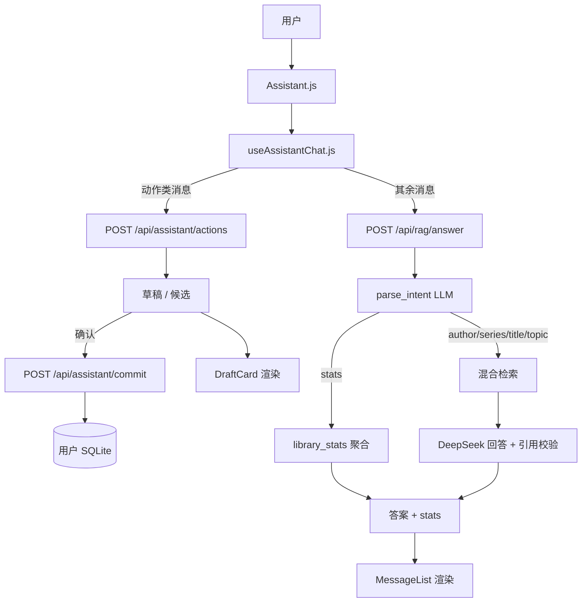
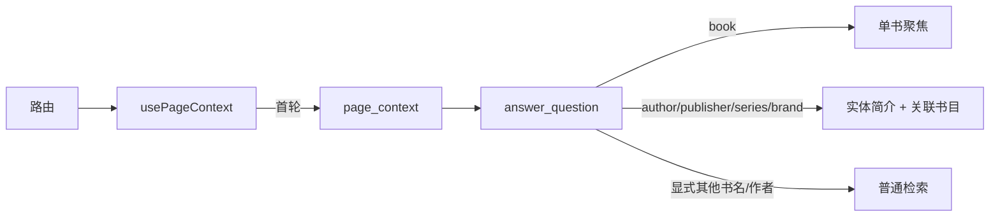
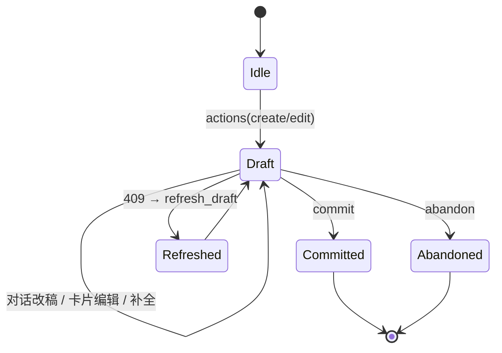

# 图书助手（Assistant）实现说明

> 适用代码版本：当前工作区（P1 录入 / P2 编辑 / 页面上下文 / 语义统计 / 购书清单 / 极值书）
> 相关计划：[`ASSISTANT_BOOK_ACTIONS_PLAN.md`](./ASSISTANT_BOOK_ACTIONS_PLAN.md)

---

## 1. 能力概览

助手是全局悬浮在页面右侧的对话入口，登录用户与游客都可用（游客只读）。它现在做四类事情：

| 能力 | 例子 | 后端入口 |
|---|---|---|
| 书库问答（RAG） | “沙陀往事讲了什么？”“托尔金还有哪些书？” | `POST /api/rag/answer` |
| 页面上下文问答 | 作者页问“介绍一下这个作者”；图书页问“介绍一下这本书” | 同上，附带 `page_context` |
| 统计问答 | “书库有多少本书”“上个月买了哪些书”“最贵的书是哪套” | 同上，语义意图命中 `stats` |
| 朝代/国家作者 | “宋代的作者有哪些”“中国宋代作者” | 同上，语义意图命中 `author_filter` |
| 作者评分 | “评分最高的作者是谁” | 按豆瓣均分查询作者 |
| 图书录入 / 编辑 | “录入 9787…”“修改《三体》的出版社” | `POST /api/assistant/actions` + `/commit` |
| ISBN 元数据 | 手动表单与助手共用 | `GET /api/isbn/{isbn}`、`POST /api/isbn/lookup` |

统计不再由前端关键词触发；所有消息统一进入 RAG 入口，由后端意图模型决定是普通问答还是统计。

---

## 2. 总体架构



### 前端模块

| 文件 | 职责 |
|---|---|
| `frontend/src/components/Assistant.js` | 悬浮按钮、面板、输入框、引用标签、页面上下文首轮、睡眠动画 |
| `frontend/src/components/assistant/useAssistantChat.js` | 消息状态、动作分流、请求、历史/已见书目、草稿提交、409 恢复 |
| `frontend/src/components/assistant/MessageList.js` | 消息气泡、图书列表（封面/点击/引用）、统计表格、更多按钮 |
| `frontend/src/components/assistant/DraftCard.js` | 录入/编辑草稿卡：字段编辑、来源、缺失、diff、冲突、重复 ISBN 三选一 |
| `frontend/src/components/assistant/CandidateList.js` | 多本书候选选择 |
| `frontend/src/hooks/usePageContext.js` | 从路由解析当前详情页实体 |
| `frontend/src/hooks/useSleepingFox.js` | 闲置 1 分钟睡觉、1 分钟醒来的循环 |
| `frontend/src/AuthContext.js` | 账号/游客会话、`isAuthenticated`/`isGuest` |

### 后端模块

| 文件 | 职责 |
|---|---|
| `backend/routers/rag.py` | `/api/rag/answer`、`/search`、`/reindex`、`/status` |
| `backend/rag/answer.py` | 检索门控、页面上下文、更多、改写、统计分流、回答与引用校验 |
| `backend/rag/intent.py` | 语义意图：author / series / title / topic / stats |
| `backend/rag/llm.py` | DeepSeek Flash 传输层 |
| `backend/routers/assistant.py` | `/actions`、`/commit` |
| `backend/services/assistant_actions.py` | 草稿构建、改稿、提交、实体解析、审计 |
| `backend/services/assistant_stats.py` | 统计语义结果校验/渲染、购书清单、极值书 |
| `backend/services/library_stats.py` | 书库统计聚合（`/api/stats/books` 共用） |
| `backend/services/metadata/*` | 豆瓣/当当/外文元数据、合并、缓存、限流、封面 |
| `backend/routers/isbn.py` | ISBN 查询与组合检索 |
| `backend/routers/stats.py` | 现有统计 API（`/summary`、`/visits`、`/books`） |

---

## 3. 前端交互

### 3.1 显示与登录

- `/login`、`/register` 永远不显示；
- 其余页面始终显示；未登录时后端使用 `demo.db`（只读）；
- 账号登录会清除游客标记；游客登录写入 `localStorage['my_library_guest']`；
- 游客/未登录可以问答/统计；录入/修改类消息在前端直接提示“未登录用户不能执行该动作”，不会发起写请求；账号登录后才允许写入。

### 3.2 睡眠动画

- 60 秒无操作 → 切换为 `fox_sleep_*` 动画，持续 60 秒后醒来，循环；
- 输入、发送、点击触发器、示例、引用、关闭、新对话都会 `touch()` 唤醒；
- 睡眠图是 3:4 竖版，用 `is-sleeping` class 放大到与清醒图同宽（触发按钮 160px、头像 128px）。

### 3.3 请求分流

```js
actionLike = Boolean(draft) || looksLikeAction(query, focusBookId)
```

- `draft` 存在：任何输入都当作“修改草稿”发给 `/actions`；
- 命中动作词 + ISBN / 引用 / 编辑书名的消息：`/actions`；
- 其余全部走 `/rag/answer`（统计也在后端判定）；
- 页面上下文只在进入详情页后的**第一轮**发送；发过一次后由对话历史接管。

### 3.4 消息与渲染

RAG 响应被映射为一条 assistant 消息：

```js
{
  content,                 // 答案文本
  books: sources,          // 标准图书列表（封面、点击、引用）
  statsTable: stats?.table,// 统计表格（仅有表格的统计）
  focused, scope, hasMore, noAnswer, rewritten
}
```

- `stats.books` 会作为 `sources` 返回，因此统计里列出的书与普通 RAG 一样显示为可点击/可引用列表；
- 纯数量/分布统计（总数、排行、占比）仍用 `statsTable` 小表格；
- “还有更多”按钮仅在 `hasMore` 时出现，继续请求会带 `seen_book_ids`；
- 历史消息单条最多截断到 4000 字符（后端接受更长输入并在归一化时截断），避免超长回答再次作为 history 触发 422。

### 3.5 草稿卡

- 创建：封面、书名、作者、出版社、日期、页数、定价、装帧、ISBN，可展开“更多字段”；
- 编辑：只显示/写入变更字段，`current → value` diff；
- 触发按钮：`确认录入`/`确认修改`/`取消`/`用元数据补全`/`手动录入`；
- 同 ISBN：`更新已有 / 新增一本 / 放弃`，并给出“查看已有书”链接；
- 409：前端自动调用 `refresh_draft`，按最新数据重建草稿并提示再次确认。

---

## 4. 后端 API

### 4.1 `POST /api/rag/answer`

请求：

```json
{
  "query": "上个月买了哪些书",
  "top_k": 5,
  "history": [{"role": "user", "content": "..."}],
  "seen_book_ids": [1, 2],
  "focus_book_id": 42,
  "page_context": {"kind": "author", "id": 7}
}
```

- `history` 最多 20 轮（40 条消息）；
- `seen_book_ids` 用于“还有么”；
- `focus_book_id`：引用某本书；
- `page_context.kind`：`book | author | publisher | series | brand`。

响应：

```json
{
  "query": "...",
  "answer": "...",
  "sources": [{"book_id": 1, "title_cn": "...", "authors": ["..."], "thumb_image": "..."}],
  "no_answer": false,
  "rewritten_query": "",
  "more": [],
  "has_more": false,
  "reason": "",
  "scope": "book | author | null",
  "stats": {
    "answer": "...",
    "table": {"columns": ["项目", "数值"], "rows": [["藏书", 2616]]},
    "books": [],
    "query": {"metric": "overview"}
  }
}
```

`reason` 取值：`no_candidates`、`model_none`、`no_citation`、`invalid_citation`、`no_more`。

### 4.2 `POST /api/assistant/actions`（登录）

```json
{"message": "录入 9787020158065", "draft": null, "focus_book_id": null, "page_context": null}
```

或结构化动作：

```json
{"action": "edit_book" | "refresh_draft" | "fill_missing", "focus_book_id": 42, "draft": {...}}
```

响应：

```json
{
  "intent": "create_book | update_book | revise_draft | none",
  "draft": { "...": "..." },
  "candidates": [],
  "message": ""
}
```

**只读**：该接口不写库，只构建草稿/候选/diff。

### 4.3 `POST /api/assistant/commit`（登录）

```json
{"draft": {...}, "duplicate_choice": "update | add | abandon | null"}
```

- 创建：要求 ISBN + 书名；作者/出版社按名称精确匹配，不存在则创建；
- 更新：只写草稿内字段；`updated_at` 不一致返回 409；
- 重复 ISBN：无 choice 返回 409；`abandon` 不写；`add` 允许重复；
- 失败回滚，返回可读错误。

### 4.4 ISBN

- `GET /api/isbn/{isbn}`：用户库 → root.db → 外部元数据；作者/出版社解析或创建；
- `POST /api/isbn/lookup`：ISBN + 书名/作者/出版社/日期组合检索；最多 3 个候选，强匹配才自动采用；
- 公开只读，带外部源限流/缓存。

---

## 5. RAG 回答链路

`answer_question()` 的优先级：

1. **引用聚焦**：`focus_book_id` 存在 → 只用这本书；若问题要“作者其他作品”则扩展到该作者；
2. **页面上下文**：`page_context` 存在且问题指向该页面（这个/该/他/介绍…）→ 实体简介 + 关联书目；
   - 问题里显式提到**其他书名/作者**时，页面上下文失效，走全库检索；
   - “这个月/上个月”不当作页面指代，交给统计；
3. **继续看更多**：命中“还有/更多/列出来/具体说说…” → `_answer_more`；
4. **普通问答**：跟随历史改写 → 语义意图 → 统计或检索。

### 5.1 检索

- 标题快路径：查询点名某作品时直接取该作品（含版本），不进入模糊检索；
- FTS/BM25 关键字门控：保留 BM25 ≥ 最优 50% 的命中；
- 向量回退：FTS 为空时，保留余弦 ≥ 0.58 的命中；
- 候选池 40，回答最多 5 本；按作品去重，避免多版本占满名额；
- 作者/系列意图会先解析实体直接取书（例如“托尔金著的书”不会返回传记）。

### 5.2 回答与引用

- 用候选书构建严格提示词：只能使用候选/当前页面信息，不得编造；
- 模型必须输出 `[book_id=N]`；
- 无引用、`NONE`、或引用不在候选集 → 返回 `no_answer`；
- 多本书比较要求分别引用；
- 回答尾部引用标记会被剥离，sources 按引用顺序返回。

### 5.3 更多与历史

- “还有么”使用 `seen_book_ids` 排除已展示书目；
- 无主语/带指代追问（“他还有哪些书”“这个系列还有什么”）先按历史改写，再沿用意图；
- 作者/系列追问按对应实体续页；
- 池空返回 `no_more`。

### 5.4 页面上下文



- 首轮后前端停止发送 `page_context`，后续完全由历史驱动；
- 显式朝代作者问题（“宋代的作者有哪些”）以及显式其他书名/作者会绕过页面上下文；
- 这样“作者页问托尔金 → 问红楼梦 → 再问作者”会落到曹雪芹，而不是托尔金。

---

## 6. 语义意图

`rag/intent.py::parse_intent` 一次 Flash 调用，输出：

```json
{"kind": "author | series | title | topic | stats | author_filter", "value": "..."}
```

朝代作者时 `value` 是对象：

```json
{"dynasty": "宋", "nation": "中国"}
```

统计时 `value` 是对象：

```json
{
  "metric": "overview|read_state|average|spend|spend_month|purchase_list|extreme|top|breakdown|timeline|timeline_month|purchase_timeline",
  "group_by": "category|author|publisher|binding|language|score",
  "field": "price|purchase_price|pages|douban_score|book_count",
  "order": "max|min",
  "period": "month|year",
  "year": 2026,
  "month": 10,
  "limit": 5
}
```

- 提示词中注入当天日期，避免“这个月/今年”解析错；
- 统计命中后**不进入检索、不调用回答模型**；
- 朝代作者（author_filter）直接按 `authors.dynasty` / `nation` 查作者及藏书数，不进入检索；
- 作者评分问题按豆瓣均分查询作者，不会误答成评分区间或单本极值；
- 统计意图若参数不完整，回退到确定性解析；
- 页面详情页上的朝代作者问题不会被页面实体劫持。

---

## 7. 统计能力

### 7.1 数据来源

复用 `services/library_stats.build_book_stats(db)`（原 `/api/stats/books`）：

- overview：藏书/作者/出版社/分类/总花费/均价；
- by_read_state、by_category、by_binding、by_language、by_score、by_compose；
- top_authors、top_publishers；
- timeline_months / timeline_years（按 `created_at`）；
- purchase_months / purchase_years（按 `purchase_date` 与实付价）。

### 7.2 语义指标

| metric | 说明 | 输出 |
|---|---|---|
| overview | 总量 | 表格 |
| read_state | 阅读状态分布 | 表格 |
| average | 均价/平均购入价 | 表格 |
| spend / spend_month | 总花费 / 某月购书 | 表格 |
| purchase_list | 某年/某月买了哪些书 | **书目列表** |
| extreme | 最贵/最便宜/页数/评分/册数极值 | **书目列表** |
| top / breakdown | 作者/出版社/分类/装帧/语言/评分 | 表格 |
| timeline / timeline_month | 入库时间线 | 表格 |
| purchase_timeline | 购书时间线 | 表格 |

### 7.3 书目列表统一渲染

- `purchase_list` 与 `extreme` 返回 `sources` 书目（含 `thumb_image`），前端复用标准图书列表；
- 这些结果 `table` 为空，避免表格与列表重复；
- 每本书可点击进详情、可点引用按钮，引用后继续追问。

### 7.4 限制

- 阅读状态没有时间维度，“这个月读了多少本”只能给全库状态并明确说明；
- 入库时间线依赖 `created_at`，购书依赖 `purchase_date`；缺失时只能返回“没有记录”；
- 统计聚合包含库内全部书（含归档/心愿），与 `/api/stats/books` 一致。

---

## 8. 元数据服务

### 8.1 数据源

| 源 | 用途 | 方式 |
|---|---|---|
| 豆瓣 | 封面、简介、目录、作者、出版社、日期、评分、译者、装帧 | `book.douban.com/isbn/<ISBN>` 页面解析；封面需带 `Referer` |
| 当当 | 价格、出版社、日期、装帧、ISBN、封面 | 搜索页（GB18030 编码查询）+ 解析 |
| Google Books / Open Library | 外文 ISBN 兜底 | `services/isbn_lookup.py` 旧链 |
| 京东 | 不做 | 无 ISBN 查询 API，抓取有验证码 |

### 8.2 合并规则

- 规范字段：`isbn, title, title_cn, author_names, publisher_name, publish_date, pages, price, binding_type, translator, language, summary, introduction, catalog, thumb_image, douban_score, tags`；
- 字段权威：价格优先当当，其余优先豆瓣；缺失才回退；
- 冲突不静默覆盖：`conflicts` 记录各源值（截断展示），默认取权威值；
- `missing` 列出缺失字段；
- `author_intro` 等额外字段放 `extra`，不透传到草稿字段。

### 8.3 缓存、限流、封面

- 缓存：`DATA_DIR/metadata_cache.db`，TTL 30 天，key 为 ISBN/查询；
- 限流：每源串行，默认 2.5 秒间隔；5–10 秒超时；403/418/429 冷却 10 分钟；
- 封面：服务端下载 → `DATA_DIR/media/images/books/<sha1>.<ext>`；`thumb_image` 存 `/images/books/...`；
- 媒体路由 `/api/media/{path}` 本地优先、CDN 回退；
- 下载失败不会把外链封面写进书库。

---

## 9. 图书录入 / 编辑

### 9.1 草稿生命周期



### 9.2 创建

- ISBN 规范化（ISBN-10 → 13，去连字符）；
- 元数据查询 → 草稿；
- 同 ISBN 已存在：更新/新增/放弃；
- 确认后作者/出版社精确匹配或创建，品牌/系列/分类/书架只匹配已有项；
- 事务写入，审计日志 `DATA_DIR/assistant_actions.jsonl`。

### 9.3 编辑

- 定位：引用当前书 > 书名/作者搜索（多候选选择）> ISBN；
- 只写变更字段；`updated_at` 并发校验；
- 支持全字段：基础元数据、购入信息、阅读状态、书架/分类/品牌/系列、纸张/装帧形式/册数/版次/印次/印数、登记/心愿单/链接；
- “用元数据补全”只填当前为空的字段；
- 简介/目录等长文本可通过对话修改（卡片内不展开编辑）。

### 9.4 审计

- `assistant_actions.jsonl` 记录：user_id、action、book_id、字段名、来源、状态、时间；
- 不记录字段值，避免敏感/大文本。

---

## 10. 权限、数据与配置

### 10.1 权限

- 读接口（RAG、统计、ISBN）公开；匿名用户走 `demo.db`；
- `/api/assistant/actions`、`/commit` 必须 Bearer 登录；
- 写入只作用于当前用户自己的 SQLite；
- 游客可问答/统计，但动作接口 401。

### 10.2 配置项

| 变量 | 作用 |
|---|---|
| `DEEPSEEK_API_KEY` | 回答、意图、改写、动作改稿；缺失时问答/语义统计不可用 |
| `DATA_DIR` | 用户库、缓存、封面、审计日志根目录（默认 `/app/data`） |
| `METADATA_MIN_INTERVAL` | 元数据源最小请求间隔（秒，默认 2.5） |
| `METADATA_CACHE_PATH` | 覆盖元数据缓存路径 |
| `MEDIA_LOCAL_DIR` | 覆盖本地封面根目录 |
| `MEDIA_CACHE_ENABLED` | `/api/media` 是否缓存 CDN 响应 |
| `DOUBAN_KEY` / `GOOGLE_BOOKS_API_KEY` | 旧 ISBN 链可选 key（当前主链为页面解析，不依赖） |

### 10.3 存储

- 用户库：SQLite（books/authors/publishers/… + `book_vectors`/`book_fts`）；
- 元数据缓存：独立 SQLite；
- 封面：`data/media`；
- 审计：JSONL。

---

## 11. 测试

```bash
cd backend && DATA_DIR=/tmp .venv/bin/python -m pytest -q
cd frontend && CI=true npx react-scripts test --watchAll=false
```

当前结果：

- 后端 **376 passed**；
- 前端 **92 passed**（4 个 `Books.test`/`App.test` 既有失败，与助手无关）。

关键覆盖：

- `tests/test_rag_answer.py`：检索/意图/页面上下文/统计分流/引用校验/更多；
- `tests/test_assistant_actions.py`：创建/编辑/重复 ISBN/并发/补全/审计；
- `tests/test_metadata.py`：豆瓣/当当解析、合并、缓存、限流、封面、查询接口；
- `tests/test_assistant_stats.py`：语义统计、购书清单、极值书、书目列表；
- `Assistant.test.js` / `DraftCard.test.js`：分流转发、草稿、引用、统计、页面上下文、409 恢复。

---

## 12. 已知限制与后续

1. 动作触发仍由前端关键词做第一层分流（ISBN/动作词/引用）；统计与 RAG 已语义化。后续可把动作也并入统一语义路由。
2. 统计的阅读状态没有时间维度；入库/购书依赖 `created_at`/`purchase_date`。
3. 豆瓣/当当为页面抓取，存在版式变化与 ToS 风险；解析器有 fixture 测试，失败会降级手动录入。
4. 京东未接入（无 ISBN 查询 API，抓取有验证码）。
5. 对话框扫码按钮尚未接线（直接输入 ISBN 可用）。
6. 草稿卡不内联编辑简介/目录等长文本（可用对话修改）。
7. 无流式输出；一次问答通常 1–2 次模型调用。
8. 购书清单最多返回 50 本、极值榜单最多 5 本；回答文本只列前 20 本，完整列表在 sources。

---

## 13. 代码地图

```
frontend/src/
  components/Assistant.js
  components/assistant/{useAssistantChat,MessageList,DraftCard,CandidateList}.{js,css}
  hooks/{usePageContext,useSleepingFox}.js
  AuthContext.js
backend/
  routers/{rag,assistant,isbn,stats}.py
  rag/{answer,intent,llm}.py
  services/
    assistant_actions.py
    author_profiles.py
    assistant_stats.py
    library_stats.py
    isbn_lookup.py
    metadata/{service,fields,cache,http,rate_limit,douban,dangdang,foreign,covers}.py
docs/
  ASSISTANT_BOOK_ACTIONS_PLAN.md
  ASSISTANT_IMPLEMENTATION.md
```

---

## 14. 快速联调

```bash
# 普通问答
curl -s -X POST http://127.0.0.1:8000/api/rag/answer \
  -H 'Content-Type: application/json' \
  -d '{"query":"红楼梦的作者是谁？"}'

# 页面上下文
curl -s -X POST http://127.0.0.1:8000/api/rag/answer \
  -H 'Content-Type: application/json' \
  -d '{"query":"介绍一下这个作者","page_context":{"kind":"author","id":70}}'

# 语义统计（命中后返回 stats，不调用回答模型）
curl -s -X POST http://127.0.0.1:8000/api/rag/answer \
  -H 'Content-Type: application/json' \
  -d '{"query":"上个月买了哪些书"}'

# 录入草稿（需 Bearer）
curl -s -X POST http://127.0.0.1:8000/api/assistant/actions \
  -H 'Content-Type: application/json' -H "Authorization: Bearer $TOKEN" \
  -d '{"message":"录入 9787020158065"}'
```

> 本地镜像：`docker compose build backend frontend && docker compose up -d`；
> 生产：`./build.sh push` + `deploy.sh`。
